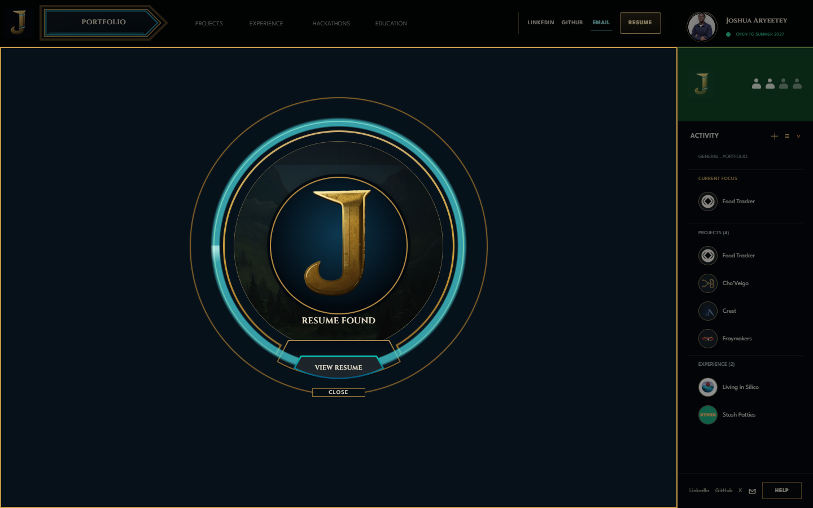

# Resume Found owner geometry comparison

## Owner-defined layer mapping

The owner's latest sketch defines one layered mechanism:

1. The J and `RESUME FOUND` title occupy the inner scenic/orb zone.
2. A bounded cyan channel fills within the middle ring and remains illuminated.
3. `VIEW RESUME` sits inside the lower trapezoid plate attached to that middle band.
4. `CLOSE` attaches to the lower portion of the outer gold ring.

The Figma mechanism is file `9zvk9iSRPKSsJ6llDJrQmA`, node `2407:340`. Its cyan measuring circuit is `2407:343` (464×464px) and inner gold race is `2407:344` (424×424px), inside the 530×530px parent. The webpage maps the 464px channel to 87.55% of the mechanism and masks the cyan gradient into an annulus.

## Browser captures

Captured with installed Chrome 154 / Playwright from the current worktree:

- Empty ring at 1440×900: [empty-1440x900.png](empty-1440x900.png)
- Half filled at 1440×900: [half-1440x900.png](half-1440x900.png)
- Full settled at 1440×900: [settled-1440x900.png](settled-1440x900.png)
- Full settled at 390×844: [settled-390x844.png](settled-390x844.png)
- Reduced motion at 1440×900: [reduced-motion-1440x900.png](reduced-motion-1440x900.png)
- Measured geometry, computed fill, and asset loading: [render-report.json](render-report.json)

The desktop mechanism measures 530×530px at approximately `(335,170)`. The J ends at y≈555; the title begins at y≈557 in the lower central zone. The View Resume plate is 170×56px at approximately `(515,623)`. Close is 94px wide at y≈688 and meets the outer ring's lower edge at y≈700. At 390px, the 358px mechanism and its controls fit without horizontal overflow; the page retains natural vertical scroll.

The ring samples show 0°, 180°, and 360° fill. The final image keeps the full cyan ring visible. Reduced motion renders the completed ring immediately with no animation. The current render was visually inspected against the Figma layer geometry and owner placement rules; the newer owner screenshot is treated as problem evidence, not the desired final composition.

Focused component tests passed **19/19**. Independent Runtime QA confirmed the same geometry and checked focus trapping/restoration, Escape, Close, View Resume, inert underlay, reduced motion, narrow layout, and loaded assets. Browser interaction results are in [QA-interactions.md](QA-interactions.md) and [qa-interactions.json](qa-interactions.json). No console/page/request errors were reported. This is implementation verification; owner acceptance remains open.
