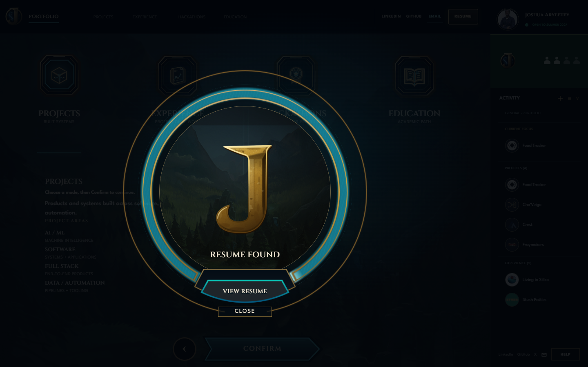
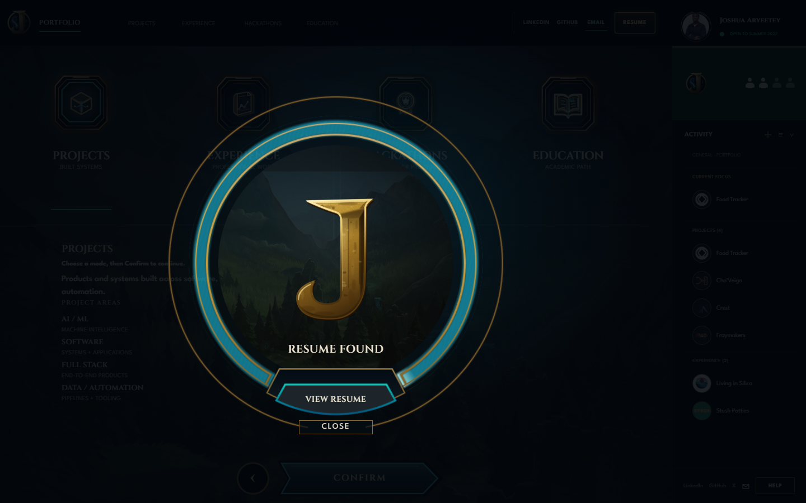

# Owner correction checkpoint — banners, Resume, identity

## Review build

- **Feature branch:** `feat/portfolio-integration`
- **Application source:** `dc65663a64934f8fb2c8b26c9df0fef232f8fe8d`
- **Immutable Preview:** <https://d17a1370.joshuaik2.pages.dev/>
- **Cloudflare deployment:** `d17a1370-69ef-4c00-a981-d5cc010699e3` (`Preview`, branch `feat/portfolio-integration`, source `dc65663`)
- **Production:** untouched.

The first deployment made during this pass (`0d3de5a3`) was built from the dirty correction worktree and included a preserved, uncommitted Opening timing edit. It is not the review build. Its URL remains as deployment history; use `d17a1370` for owner review. The final Preview was rebuilt in a clean detached worktree from the exact application commit above. No dirty or untracked J/Opening studies were included.

## Correction ledger

| Surface | Status | Result |
|---|---|---|
| Four category lobbies | **IMPLEMENTED + VISUALLY VERIFIED** | The current centered, bounded banner groups, symmetric balance slots, and midpoint `+` controls were already in the feature source. Chrome review covered Projects, Experience, Hackathons, and Education at 1920×1080, 1440×720, 2560×1080, and 390×844. The top-origin experiment remains reverted: it lost the lower woodland scene and left excess open sky. |
| Resume Found | **IMPLEMENTED + VISUALLY VERIFIED; OWNER REVIEW OPEN** | Removed the extra one-pixel gold CSS stroke from the scenic aperture; the Figma mechanism has no such stroke. Kept the standalone Sonnet J, scenic field, authentic outer mechanism, bounded cyan channel, attached View Resume plate, and Close at the outer-ring base. No speculative size or position changes were needed after comparing the three supplied owner screenshots and the Figma geometry. Desktop modal, empty/partial/full channel states, and narrow state were rendered. |
| Resume Viewer | **IMPLEMENTED + VISUALLY VERIFIED** | The shared portfolio header remains in place. View Resume reaches the Viewer; Download PDF and Open Fullscreen remain visible. The deployed PDF endpoint returns `200 application/pdf`. Desktop and narrow Viewer captures are included. |
| Activity identities / Projects owner banner | **PRESERVED + VISUALLY VERIFIED** | Home and shared Activity use the canonical marks; Living in Silico and Stush match their Experience identities. Projects keeps the J in the top-left shared brand and Joshua’s portrait in the central owner card. No identity redesign was made. |
| Opening / J | **PRESERVED — OWNER APPROVED** | No Opening or J changes are included in this application commit. Existing dirty J/Opening edits and study artifacts in the main worktree remain untouched and unstaged. |
| Home, Profile, Journey, Highlights, case studies | **PRESERVED — OWNER APPROVED** | No broad redesign or content rewrite in this checkpoint. Profile’s broader lower-scene composition remains owner-review open; it was not marked fixed. |

### Resume visual evidence

The previous Preview and current application render use the same 1440×900 modal state. The code difference is intentionally small: removal of a non-Figma scenic-aperture stroke. The owner’s controls, mechanism scale, and layout were otherwise retained.

**Before — Preview `7e03e139`:**

**After — application source `dc65663`:**

Progress comparisons: [empty](evidence/resume-after-empty-1440x900.png), [partial](evidence/resume-after-partial-1440x900.png), [completed](evidence/resume-after-full-1440x900.png), [narrow 390×844](evidence/resume-after-full-390x844.png). Resume Viewer: [desktop](evidence/resume-viewer-1440x900.png), [narrow](evidence/resume-viewer-390x844.png).

Lobby and identity captures: [Projects](evidence/projects-lobby-1920x1080.png), [Experience](evidence/experience-lobby-1920x1080.png), [Hackathons](evidence/hackathons-lobby-1920x1080.png), [Education](evidence/education-lobby-1920x1080.png), [Home / Activity](evidence/home-activity-identities-1440x900.png). The complete local viewport and overlay matrix is retained in `docs/site-render-review/2026-10-12-partial-owner-review/runtime-qa-evidence/`.

## Verification

- Full clean-source test suite: **305 tests across 31 files passed**. Happy DOM prints iframe/PDF fetch-abort teardown traces while exiting successfully.
- `npm run build`: passed; existing advisory remains for the 519.12 kB JavaScript chunk.
- `git show --check`: passed for both the application correction commit `dc65663` and the documentation/evidence commit `43d0709`.
- Clean Preview bundle verification: deployed JavaScript SHA-256 `e5c576fec09126eda6c80c6c9f906d0591f08cf8d1aa10a80badd366f91f8506`; deployed CSS SHA-256 `6e2220a7eb02e0785d7286f6ad6aa254491a757b56479193a6714860531104a2`. Both match the clean build from `dc65663` byte-for-byte.
- Preview routes `/`, `/home`, `/projects`, `/experience`, `/hackathons`, `/education`, `/resume`, `/resume/viewer`, `/profile`, `/journey`, and `/demos` returned HTTP 200. The PDF endpoint returned HTTP 200 with `application/pdf`.
- The deployed Preview was visually checked in the Codex browser at Home, Projects, Resume Found, and Resume Viewer. Runtime QA also inspected the local clean-equivalent UI in Chrome 154 across desktop and narrow dimensions; modal actions, focus restoration, Escape, and responsive fit passed.
- Live screen-reader interaction was not performed. Automated accessibility checks do not replace that manual review.

## Remaining review notes

- **Owner review remains open** for the visible Resume mechanism and lobby compositions; passing checks are not owner acceptance.
- The broader Profile lower-scene spacing is still open for owner judgment.
- Food Tracker still has no authentic demo video. Cho’Veigo’s owner-authorized original full recording remains unchanged in the portfolio media path.
- The portfolio goal remains active. This immutable Preview is a review checkpoint, not completion.
