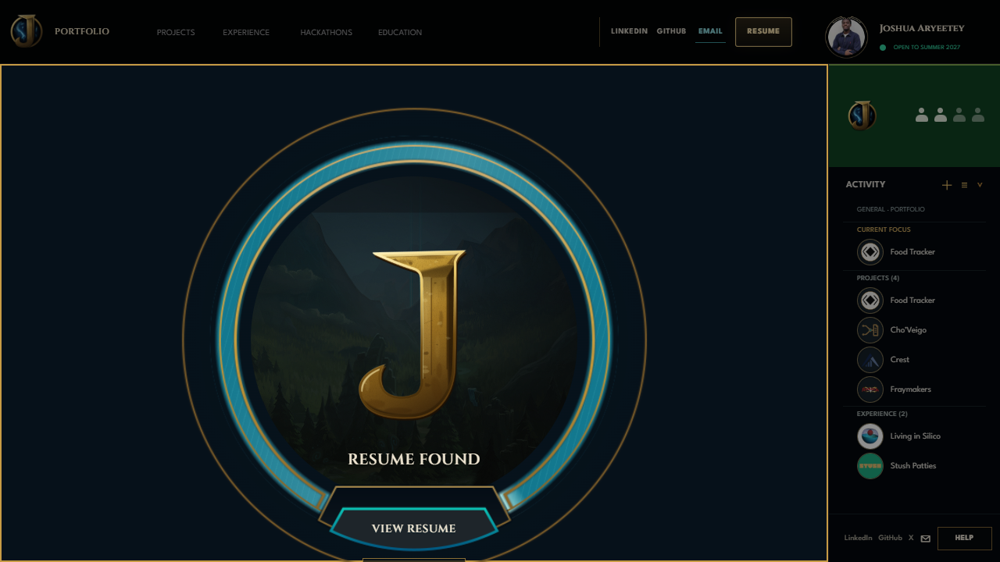
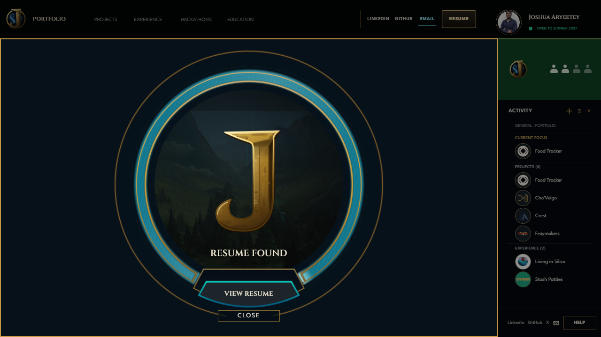
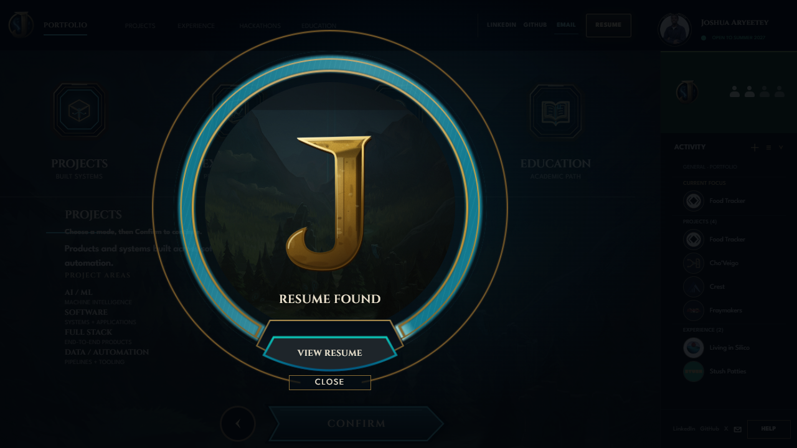

# Review checkpoint — owner correction pass

**Status:** REVIEW CHECKPOINT READY — owner review remains open; the persistent portfolio goal is active.

- **Branch:** `feat/portfolio-integration`
- **Application source:** `39ad7ddd28a8b0d240c8f39386354cdfa731635c`
- **Immutable Preview:** [https://9b8a4661.joshuaik2.pages.dev/](https://9b8a4661.joshuaik2.pages.dev/)
- **Cloudflare:** Preview environment, feature branch `feat/portfolio-integration`, deployment `9b8a4661-9d8c-4d12-bf7d-4a4874eedd46`, reported source `39ad7dd`

## What changed

The final deployed-source visual check found that direct `/resume` overflowed at 1280×720: the Close control extended below the viewport. A focused regression test was added, then a short-desktop-only rule was introduced to scale the complete mechanism into the available height. Other correction-pass application work was preserved: centered bounded lobby groups and midpoint controls, historical background framing, canonical Activity identities, the Projects owner portrait, shared Resume Viewer header, and the bounded completed cyan channel in Resume Found. No production deployment occurred.

## Short-screen before/after

At 1280×720, before the final fix, `/resume` had a 638px viewport but 675px of content; the 597px composition bottom was y=733.1 and Close bottom was y=740.2. After the fix, content height equals the 638px viewport; the composition is 574px tall and Close ends at y=686.9.

The modal fits too. Escape returns to Home and restores focus to the Resume opener; View Resume reaches the viewer; reduced motion shows the completed ring immediately. The 1440×900 and 390×844 mechanism sizes remain 600px and 358px. Full metrics: [short-height before/after](qa/short-height-resume-fix/before-after-1280x720.json) and [final Preview QA](qa/preview-9b8a4661/preview-qa.json).

## Other visual evidence

- Lobby comparison at 1440×900: Projects [before](after/preview-lobby-projects-1440x900.png) → [after](after/local-lobby-projects-1440x900.png); Experience [before](after/preview-lobby-experience-1440x900.png) → [after](after/local-lobby-experience-1440x900.png); Hackathons [before](after/preview-lobby-hackathons-1440x900.png) → [after](after/local-lobby-hackathons-1440x900.png); Education [before](after/preview-lobby-education-1440x900.png) → [after](after/local-lobby-education-1440x900.png).
- Current narrow lobby renders: [Projects](after/local-lobby-projects-390x844.png), [Experience](after/local-lobby-experience-390x844.png), [Hackathons](after/local-lobby-hackathons-390x844.png), [Education](after/local-lobby-education-390x844.png). The complete four-route/five-viewport capture matrix is summarized in the [QA report](qa/qa-report.md).
- Resume fill states at desktop: [beginning](../2026-10-12-resume-owner-progress-audit/after/desktop-1440x900-beginning-36deg.png), [partial](../2026-10-12-resume-owner-progress-audit/after/desktop-1440x900-partial-153deg.png), [completed](../2026-10-12-resume-owner-progress-audit/after/desktop-1440x900-full-306deg.png), [channel close-up](../2026-10-12-resume-owner-progress-audit/after/desktop-1440x900-full-306deg-mechanism-crop.png), [reduced motion](../2026-10-12-resume-owner-progress-audit/after/desktop-1440x900-reduced-motion-settled.png).
- Resume fill states on narrow: [beginning](../2026-10-12-resume-owner-progress-audit/after/narrow-390x844-beginning-36deg.png), [partial](../2026-10-12-resume-owner-progress-audit/after/narrow-390x844-partial-153deg.png), [completed](../2026-10-12-resume-owner-progress-audit/after/narrow-390x844-full-306deg.png), [channel close-up](../2026-10-12-resume-owner-progress-audit/after/narrow-390x844-full-306deg-mechanism-crop.png), [reduced motion](../2026-10-12-resume-owner-progress-audit/after/narrow-390x844-reduced-motion-settled.png).
- Resume Viewer desktop/narrow: [desktop capture](qa/preview-9b8a4661/resume-viewer-desktop-1440x900.png), [narrow capture](qa/preview-9b8a4661/resume-viewer-narrow-390x844.png)
- Browser results: [QA report](qa/qa-report.md)

## Verification and remaining review

Full suite: **307 tests across 31 files passed**. `npm run build`, `git show --check`, and `git diff --check HEAD^ HEAD` passed. Deployed JavaScript SHA-256 `E5C576FEC09126EDA6C80C6C9F906D0591F08CF8D1AA10A80BADD366F91F8506` and CSS SHA-256 `E3C3B09B32EAF9C265F60C7596391E4C8F7B66A5364CE19F364812C5587459C6` match the clean build. All 20 app routes returned 200; the resume PDF returned `application/pdf`. Preview Chrome checks found no page errors, bad responses, broken visible assets, or horizontal overflow. The existing Vite chunk-size advisory and test-runner PDF iframe teardown traces remain.

The original Cho’Veigo full recording remains unchanged and matches the owner-provided SHA-256 `1C637A4AD7A197D7073DA88534CF8D54B660C85DF16B75FA25F955D16E94C801`. Live screen-reader interaction remains a manual accessibility follow-up. Visual owner acceptance remains open; this checkpoint does not declare the portfolio complete. Historical and unrelated dirty/untracked artifacts remain preserved.
